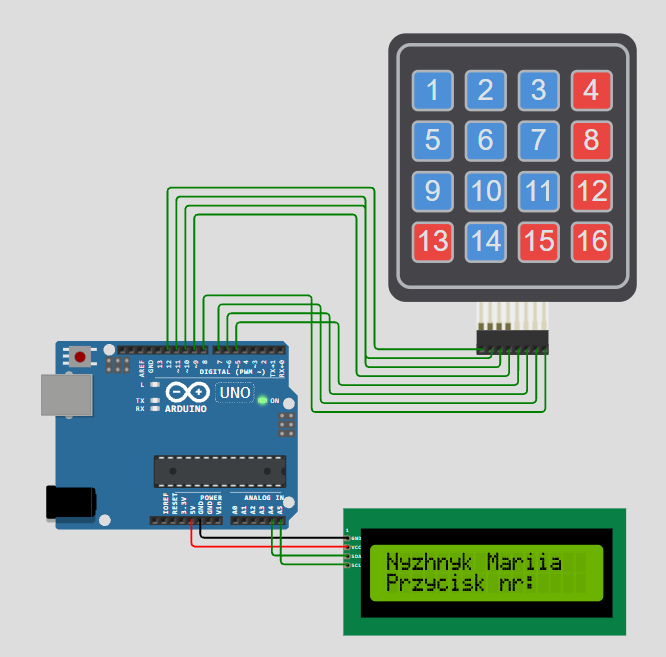

# ⌨️ Arduino Keypad & LCD Display Reader

This project uses an **Arduino Uno**, a **4x4 matrix keypad**, and an **LCD display with an I2C module** to read button presses and display their corresponding numbers (from 1 to 16) in real time.

---

## 🧠 Functionality

1. **Header Display:** When powered on, line 1 shows the author's name (`Nyzhnyk Mariia`), and line 2 displays the static prefix (`Przycisk nr:`).
2. **Key Detection:** When a button on the 4x4 matrix keypad is pressed, its numeric ID (1 through 16) is registered instantly.
3. **Real-Time Display Update:** The pressed button number updates dynamically right after `Przycisk nr:`.
4. **Digit Alignment:** Single-digit numbers (1–9) automatically clear any trailing second digit from previous double-digit entries.

---

## 🧰 Components Used

- Arduino Uno
- Breadboard & Jumper wires
- 4x4 Matrix Keypad (HW-834 / 1–16 sequence)
- LCD Display (16x2 / 20x4) with PCF8574 I2C Module

---

## 🧩 Schematic

The wiring diagram for the project is shown below:

---

## 🔌 Pin Configuration

### LCD Display (I2C)
| LCD Pin | Arduino Pin |
|---------|-------------|
| VCC     | 5V          |
| GND     | GND         |
| SDA     | A4          |
| SCL     | A5          |

> **Note:** The default I2C address used in the code is `0x27`.

### Keypad Matrix (4x4)
| Keypad Pin | Function | Arduino Pin |
|------------|----------|-------------|
| Pin 1      | Row 0    | D12         |
| Pin 2      | Row 1    | D11         |
| Pin 3      | Row 2    | D10         |
| Pin 4      | Row 3    | D9          |
| Pin 5      | Col 0    | D5          |
| Pin 6      | Col 1    | D6          |
| Pin 7      | Col 2    | D7          |
| Pin 8      | Col 3    | D8          |

---

## 🖥️ Keypad Layout

| Row / Col | Col 0 | Col 1 | Col 2 | Col 3 |
|-----------|-------|-------|-------|-------|
| **Row 0** | `1`   | `2`   | `3`   | `4`   |
| **Row 1** | `5`   | `6`   | `7`   | `8`   |
| **Row 2** | `9`   | `10`  | `11`  | `12`  |
| **Row 3** | `13`  | `14`  | `15`  | `16`  |

---

🔗 **Simulation:** [Run on Wokwi](https://wokwi.com/projects/478868161555962881)