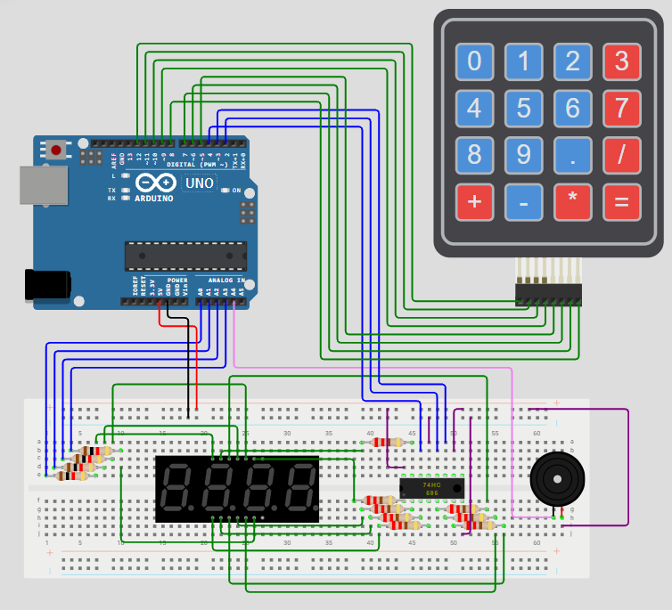

# 🧮 Arduino Calculator

This project is a 4-digit electronic calculator built using an **Arduino Uno**, a **4x4 matrix keypad**, a **74HC595 shift register** driving a 4-digit **7-segment display**, and a **piezo buzzer**.  
The user can input numbers, select arithmetic operations, and view real-time results on the display.

---

## 🧠 Game Rules & Functionality

1. **Basic Operations:** Supports addition (`+`), subtraction (`-`), multiplication (`*`), and division (`/`).
2. **Number Entry:** Numbers can be typed digit-by-digit, including floating-point decimals up to 3 decimal places.
3. **Display Limit:** Valid number range spans from `-999` to `9999`.
4. **Error Handling:**
   - Standard division by zero or number overflow triggers an error state.
   - The display shows `Err` and a warning tone sounds via the buzzer.
5. **Reset:** Pressing any key after an error or result clears the state for a new calculation.

---

## 🧰 Components Used

- Arduino Uno
- Breadboard
- 4-Digit 7-Segment Display
- 74HC595 Shift Register
- 4x4 Matrix Keypad
- Piezo Buzzer
- 8 × Current-limiting resistors (220Ω / 330Ω) for segment pins
- 4 × Resistors for digit control
- Jumper wires

---

## 🧩 Schematic

The wiring diagram for the project is shown below:

---

## 🔌 Pin Configuration

### Shift Register (74HC595)
| 74HC595 Pin | Signal | Arduino Pin |
|-------------|--------|-------------|
| DS (Pin 14) | Data | D4 |
| ST_CP (Pin 12) | Latch | D2 |
| SH_CP (Pin 11) | Clock | D3 |

### Display Digits
| Digit | Position | Arduino Pin |
|-------|----------|-------------|
| Digit 1 | Thousands (Leftmost) | A0 |
| Digit 2 | Hundreds | A1 |
| Digit 3 | Tens | A2 |
| Digit 4 | Units (Rightmost) | A3 |

### Keypad Matrix (4x4)
| Keypad Pins | Function | Arduino Pin |
|-------------|----------|-------------|
| Pin 1–4 | Rows (0 to 3) | D12, D11, D10, D9 |
| Pin 5–8 | Columns (0 to 3) | D5, D6, D7, D8 |

### Buzzer
| Buzzer Pin | Arduino Pin |
|------------|-------------|
| Positive (+) | A4 |
| Ground (-) | GND |

---

## 🖥️ Keypad & Display Interface

### Keypad Layout
- **Digits:** `0` – `9`
- **Operations:** `+`, `-`, `*`, `/`
- **Decimal:** `.`
- **Equals / Evaluate:** `=`

### Display Feedback
- **Active Typing:** Real-time feedback of typed numbers and decimal points.
- **Results:** Automatically scaled decimal placement for output values.
- **Errors:** Displays `Err` with an audible beep when an overflow or division by zero occurs.

---

🔗 **Simulation:** [Run on Wokwi](https://wokwi.com/projects/478863866416681985)
